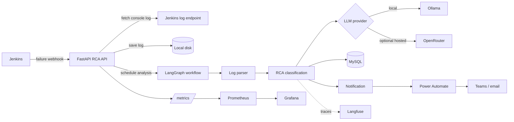

# Jenkins RCA Agent — Project Documentation

**Repository:** `lyi1cob-ayub/jenkin-learning`  
**Document location:** `agent/PROJECT_DOCUMENTATION.md`  
**Status:** Describes the configuration and implementation represented in this repository. Verify versions and licenses against the exact artifacts used for a release.

## 1. Overview

The Jenkins RCA Agent analyzes failed Jenkins builds and provides a structured root-cause analysis (RCA). It receives build metadata, downloads the Jenkins console log, extracts relevant log context, asks a configured language model to classify the failure, stores the result, and can send a notification through Power Automate to Teams/email.

An RCA includes:

- Failure domain: infrastructure, application code, or unknown.
- Root-cause summary and supporting log evidence.
- Affected component and recommended fix.
- Confidence score.

A feedback endpoint stores developer feedback in MySQL so predicted and human-confirmed outcomes can be compared. This is a decision-support tool; it does not automatically change code or rerun builds.

## 2. Scope and current limitations

**In scope:** Jenkins failure webhooks, console-log retrieval and parsing, LLM-based RCA, persistence of analyses and feedback, notifications, metrics, tracing, and local development with Docker Compose.

**Not currently provided:** automatic code/configuration changes, build retries, durable distributed job processing, multi-tenant authorization, or guaranteed correctness of LLM results.

Important implementation behavior:

- The webhook retrieves the log before responding `202 Accepted`, so log download can affect request latency.
- Workflow tasks are scheduled in-process with `asyncio.create_task`. A process restart can lose unfinished work.
- Raw logs are stored under `./tmp/jenkins_raw_logs`; the current implementation does not automatically remove them.
- The FastAPI agent is started separately; the Compose file starts its supporting services, not the agent itself.

## 3. Architecture and request flow



Typical flow:

1. Jenkins posts build metadata and a `log_url` to `POST /api/v1/analyse`.
2. The API fetches and saves the console log, schedules the workflow, and responds `202 Accepted`.
3. LangGraph runs parsing, classification, and notification nodes in sequence.
4. The model response is validated as an `RCAOutput` and analysis metadata is saved in MySQL.
5. A flat RCA payload is sent to Power Automate, which can route it to Teams/email.
6. Developers can submit feedback through the feedback API; feedback is stored in MySQL.

### Workflow nodes

| Node | Responsibility |
|---|---|
| `parse_log_node` | Calls the Jenkins log parser, selects high-priority evidence, and records safe error details in workflow state if parsing fails. |
| `classify_rca_node` | Calls the configured LLM, validates/normalizes the result, and persists the analysis. Blocking model I/O is offloaded to a worker thread. |
| `notify_teams_node` | Builds the notification payload, calls the configured webhook, and records dispatch success or failure. Automatic notification retries are not currently implemented. |

`AgentState` passes build identity, source context, log paths/snippets, RCA output, dispatch status, and error information between nodes.

## 4. Log parsing and LLM behavior

### Log parser

The parser in `app/tools/logparser.py` reads log lines sequentially. It removes ANSI sequences and timestamps, limits long lines, finds and prioritizes error patterns, captures bounded context around matches, removes nearby duplicates, and falls back to the log tail when no known pattern matches. A total character limit constrains model input.

Example limits from `env.example`:

| Setting | Example | Purpose |
|---|---:|---|
| `LOG_PARSER_MAX_CONTEXT_LINES` | 40 | Bounds context around a match. |
| `LOG_PARSER_MAX_TOTAL_CHARS` | 24000 | Limits the text sent for analysis. |
| `LOG_PARSER_MAX_LINE_LENGTH` | 2000 | Prevents an individual line from dominating the context. |

These limits reduce resource use but do not redact sensitive information or provide a security sandbox.

### LLM provider and output

- **Ollama** is the configured local inference path; `env.example` shows `qwen3:14b` as an example model.
- **OpenRouter** is an optional hosted provider; it is disabled by default in `env.example` and shows `qwen/qwen-2.5-coder-32b-instruct` as an example.
- Prompt text is stored in `app/prompts/prompts.yaml`; Langfuse can provide prompt management and tracing when configured.
- `RCAOutput` validates the failure domain, root cause, evidence, affected component, recommended fix, and confidence (0–1). Invalid model output falls back to an unknown-domain result.
- Provider/model names and prompt versions are configuration values; verify that local and Langfuse prompt version settings stay aligned.

## 5. Data and API contracts

### Persistence

MySQL stores analysis records and developer feedback. Feedback is correlated with a build/job and is deduplicated in application behavior by build, job, and user. The current schema uses SQLAlchemy/SQLModel `create_all`; it does not provide migration/version management.

Langfuse uses a separate PostgreSQL database in the Compose setup. It is not the application’s RCA/feedback database.

### Main endpoints

| Endpoint | Purpose |
|---|---|
| `POST /api/v1/analyse` | Accepts build metadata and a Jenkins console-log URL. Responds `202 Accepted` after log retrieval and workflow scheduling. |
| `GET` / `POST /api/v1/feedback` | Supports browser/email feedback links and API/Teams submissions. Business fields include `build_id`, `job_name`, and `rating`. |
| `GET /health` | Process-level health response: `{"status":"healthy"}`. It does not check dependencies. |
| `GET /metrics` | Prometheus metrics exposed through FastAPI instrumentation. |

Example analysis request:

```json
{
  "build_id": "123",
  "job_name": "sample-job",
  "log_url": "http://jenkins/job/sample-job/123/consoleText",
  "git_author_email": "developer@example.com",
  "gerrit_change_id": "https://review.example/change/123"
}
```

The notification adapter sends fields such as `failure_type`, `root_cause`, `recommended_fix`, author, change URL, job name, and build number to the configured Power Automate webhook.

## 6. Technology stack, versions, and licenses

Versions below are copied from repository configuration. A version range is not an exact installed version. Docker tags such as `latest` and `lts` can change over time. License summaries are informational; verify the license files/notices for the precise package, image, model, and release you deploy.

### Application dependencies

| Technology | Declared version | What it is used for | License / status |
|---|---|---|---|
| Python | latest | Implements the API, workflow, parsing, persistence, and integrations. | Open source; Python Software Foundation License. |
| FastAPI | `>=0.110.0` | Web API and typed endpoints. | Open source — MIT. |
| Uvicorn | `>=0.28.0` (`standard` extra) | ASGI server for FastAPI. | Open source — BSD-3-Clause. |
| Pydantic | `>=2.6.0` | Validates requests, settings, and RCA output. | Open source — MIT. |
| Pydantic Settings | Not explicitly listed | Loads settings from environment and `.env`. | Open source — MIT; version not pinned/listed. |
| LangGraph | `==1.0.5` | Orchestrates the parse → classify → notify workflow. | Python library — MIT. Separate hosting products may have separate terms. |
| LangChain Community | `==0.4.1` | Community integrations/tools. | Open source — MIT. |
| LangChain Ollama | `>=0.2.0` | LangChain connection to Ollama. | Open source — MIT. |
| SQLAlchemy | `>=2.0.35,<3.0.0` | ORM and database connection layer. | Open source — MIT. |
| SQLModel | `>=0.0.16` | Database models using Pydantic and SQLAlchemy. | Open source — MIT. |
| mysqlclient | `>=2.2.0` | MySQL driver. | Open source; GPL-2.0 terms. Verify the exact distribution and license notices, especially before redistribution. |
| PyMySQL | `>=1.1.1,<2.0.0` | Pure-Python MySQL driver. | Open source — MIT. |
| `aiofiles` | `>=24.1.0` | Asynchronous file operations for log handling. | Open source — Apache-2.0. |
| Loguru | `>=0.7.2` | Application logging. | Open source — MIT. |
| `prometheus-fastapi-instrumentator` | `>=7.0.0` | Exposes FastAPI request metrics. | Open source — MIT. |
| Langfuse Python SDK | `<3.0.0` | Sends traces to Langfuse. | Open-source SDK; exact license depends on resolved package version; verify its package metadata. |
| Requests | Not explicitly listed | HTTP calls to external services/providers. | Open source — Apache-2.0; version not pinned/listed. |
| PyYAML | Not explicitly listed | Reads YAML prompt configuration. | Open source — MIT; version not pinned/listed. |
| Tenacity | Not explicitly listed | Retries selected transient provider errors. | Open source — Apache-2.0; version not pinned/listed. |

### Services, models, and integrations

| Technology | Declared tag / example | What it is used for | License / status |
|---|---|---|---|
| Ollama | Image `latest`; example model `qwen3:14b` | Runs local LLM inference. | Ollama software — MIT. Model licensing is separate; check the exact model terms. |
| OpenRouter | Optional; example model `qwen/qwen-2.5-coder-32b-instruct` | Optional hosted inference API. | Hosted service, not an open-source dependency; provider and model terms/fees apply. |
| Jenkins | Image `lts` | CI pipelines and failure webhook trigger. | Jenkins core — MIT; plugins can use different licenses. |
| Microsoft Power Automate | Webhook configured in environment | Routes notifications and automation actions. | Proprietary hosted service; Microsoft terms/subscription apply. |
| Microsoft Teams | No version configured | Delivers failure summaries. | Proprietary hosted service; Microsoft terms apply. |
| Email provider | Configured through automation flow | Sends notifications. | Depends on provider; not specified in this repository. |

### Database, monitoring, and deployment

| Technology | Declared tag / version | What it is used for | License / status |
|---|---|---|---|
| MySQL | `8.0` | Stores analysis and feedback records. | Community Server is GPL-2.0 with the MySQL FOSS License Exception; commercial licensing is also available. Check the exact image distribution. |
| PostgreSQL | `16-alpine` | Langfuse data store. | Open source — PostgreSQL License (permissive BSD-style). |
| Langfuse | Image tag `2` | LLM prompt/trace UI and observability service. | Check the exact Langfuse 2 release and feature terms; the tag alone does not establish the license. |
| Prometheus | Image tag `latest` | Scrapes and stores metrics. | Open source — Apache-2.0. |
| Grafana | Image tag `latest` | Metrics dashboards. | Grafana OSS — AGPL-3.0; verify image edition and terms. |
| Docker Compose | File format `3.8` | Starts the supporting services. | Compose is an open-source tool; `3.8` is a file-format version, not the Compose application version. Docker Desktop may have separate terms. |


## 7. Deployment and operations

The Compose file starts Jenkins, Ollama, MySQL, Prometheus, Grafana, PostgreSQL for Langfuse, and Langfuse. The FastAPI agent is started separately.

| Service | Purpose | Default published port |
|---|---|---:|
| Jenkins | Build orchestration | 8080, 50000 |
| Ollama | Local model inference | 11434 |
| MySQL | RCA/feedback database | 3306 |
| Prometheus | Metrics collection | 9090 |
| Grafana | Dashboards | 3000 |
| Langfuse | LLM observability UI | 3001 |
| Langfuse PostgreSQL | Langfuse persistence | Internal to Compose network |
| FastAPI agent | Webhook and analysis API | 8000 when started as shown below |

Configuration is loaded from `agent/.env`; `agent/env.example` lists application, database, model, Jenkins, Teams, parser, and Langfuse settings. Never commit real passwords, tokens, API keys, proxy credentials, or webhook URLs. Replace development secrets and environment-specific addresses in deployment configuration.

### Start locally

```bash
cd agent
docker compose up -d
python -m venv .venv
source .venv/bin/activate
pip install -r requirements.txt
uvicorn main:app --host 0.0.0.0 --port 8000
```

Prepare the configured Ollama model and create `.env` from `env.example` before starting the API.

### Verify service

```bash
curl http://localhost:8000/health
curl http://localhost:8000/metrics
```

Expected health response: `{"status":"healthy"}`.


## 10. Repository map

```text
agent/
├── Jenkinsfile                 # Failure simulation and RCA webhook trigger
├── docker-compose.yaml         # Supporting services
├── env.example                 # Configuration template
├── main.py                     # FastAPI application, health, and metrics
├── prometheus.yml              # Prometheus scrape configuration
├── requirements.txt            # Python dependencies
├── PROJECT_DOCUMENTATION.md    # This project and stack documentation
└── app/
    ├── api/webhook.py          # Analyse and feedback endpoints
    ├── config.py               # Settings and environment loading
    ├── db/db.py                # SQLAlchemy engine/session/database init
    ├── graph/                  # State, workflow, and nodes
    ├── llm/client.py           # Ollama/OpenRouter/prompt/trace integration
    ├── models/                 # Pydantic and SQLAlchemy models
    ├── prompts/prompts.yaml    # Local prompt registry
    ├── tools/logparser.py      # Bounded Jenkins log parsing
    ├── tools/notifications.py  # Power Automate adapter
    └── test_app.py             # Failure-chain test scenario
```

## 11. Production priorities

1. Secure webhook ingress and validate Jenkins log URLs.
2. Remove secrets and environment-specific addresses from source-controlled configuration.
3. Redact, encrypt, and set retention for logs and prompts.
4. Move background processing to a durable queue/worker.
5. Add idempotency, migrations, notification retries, and dependency-aware readiness.
6. Govern model/prompt versions and evaluate classification quality.
7. Pin dependencies and images; add automated tests, security scans, and an SBOM.
8. Define service objectives for webhook acceptance, analysis completion, notifications, and classification quality.

## 12. Conclusion

The current implementation is a proof of concept for AI-assisted Jenkins failure triage. It separates log ingestion, bounded parsing, model-based classification, persistence, and notification. Authentication, sensitive-data controls, durable processing, governed model releases, and production-grade operational controls are the main steps toward a production-ready service.
